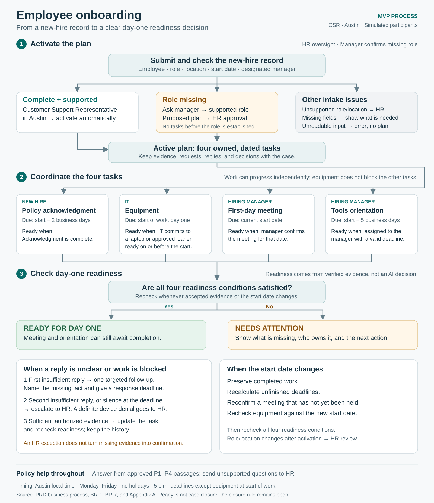

# Product Requirements Document: Automated Employee Onboarding Workflow

**Status:** Proposed Week 6 MVP baseline.  
**Product owner:** Joey.  
**Primary input:** *Employee Onboarding MRD — Business Rewrite*, November 5, 2026.  
**Selected runtime:** CrewAI, as recorded in the supplied project materials. Runtime conventions and agent allocation will be resolved in the SAD.  
**Scope:** Local demonstration using fictional employees, company policies, and HR/IT interactions.

## 1. Executive Summary

### Five-line vision

Help HR coordinators keep each new hire’s onboarding plan accurate and actionable.  
Resolve the missing information and cross-team handoffs that leave people unprepared for their first day.  
Coordinate tasks, interpret replies, update dependencies, and answer questions using approved policies.  
Give HR a clear view of confirmed arrangements, outstanding work, and decisions requiring attention.  
Keep policy exceptions and business approvals with people while the system manages follow-up and evidence.

**Problem statement.** HR, IT, hiring managers, and new hires hold different parts of the onboarding picture. An incomplete role, uncertain equipment delivery, or changed start date can make the shared plan unreliable. The MRD cites Enboarder’s 2025 survey of 1,000 HR leaders: only 36% described the recruiting-to-HR-to-manager handoff as seamless. The project has not yet measured the time or cost of these failures in a target organization.

**Solution overview.** The product maintains an onboarding plan, asks responsible people for missing facts, interprets their replies, and updates affected work. Its central demonstration is an uncertain equipment response: a possible loaner prompts a targeted confirmation request rather than an unsupported “ready” status.

**Strategic rationale.** The MRD identifies exception resolution as the product hypothesis. Existing onboarding platforms already offer task automation and adaptive workflows. The capstone will establish whether this implementation handles defined exceptions correctly; commercial advantage and savings require later validation. Intended operating benefits are fewer manual follow-ups, clearer ownership, and fewer unresolved day-one dependencies.

## 2. Market Context & User Analysis

**Initial customer hypothesis:** A mid-sized employer with separate HR and IT workflows and recurring manual coordination. The MRD places the broader employee onboarding software category at $2.53B in 2026, with a published 16.7% forecast CAGR through 2030. Those figures describe an adjacent category, not the addressable market for this MVP. Pricing and willingness to pay remain unvalidated.

**Demonstration segment:** Customer Support Representatives at a fictional Austin, Texas office. This retains the supplied PRD’s concrete scenario; it replaces the MRD’s illustrative role/location suggestion without changing its one-role, one-location scope.

**Primary journey:** Receive record → resolve a missing role and obtain HR approval when required → activate the four-task plan → coordinate replies → update affected work → review readiness. A complete, supported record activates automatically.

**User needs and adoption.** HR needs to understand the next action without reconstructing a conversation. Participants need specific requests addressed to the right owner. An additional interface or excessive reminders could add work; the prototype therefore keeps replies beside the relevant task and limits follow-up.

**Alternatives and positioning.** Workday, SAP, ServiceNow, Enboarder, and ClearCompany offer overlapping capabilities, as documented in the MRD. Email, spreadsheets, and IT tickets are additional alternatives to validate in interviews. The proposed position is a coordinator that keeps the plan and its supporting evidence consistent when circumstances change. No exclusivity or price advantage is claimed.

### Business Process Overview

The business process starts when a new-hire record is submitted. It produces an owned, dated onboarding plan and a current answer to HR’s main question: **Is this employee prepared to start, and if not, who needs to do what next?**

The MVP coordinates four tasks: policy acknowledgment, equipment readiness, a first-day manager meeting, and customer-support tools orientation. It records requests, replies, confirmations, and HR decisions beside those tasks. HR can review the remaining issues without reconstructing an entire conversation.

In the demonstration, one operator plays the HR coordinator, hiring manager, IT fulfiller, and new hire through a role selector in the browser workspace. Requests and replies are simulated local messages. In a future operating environment, these would represent handoffs between separate people and teams.

#### Process at a glance

*Figure 1. The main flow leads from intake to day-one readiness. The lower panels describe how uncertainty and start-date changes affect that flow. Detailed rules and evidence requirements follow below and in Appendix A.*

#### People and responsibilities

| Participant | Business responsibility | What they provide or decide |
|---|---|---|
| HR coordinator | Oversee the onboarding case and handle exceptions | Approve plans held for missing role information; review unsupported inputs and escalations; record decisions and reasons |
| Hiring manager | Confirm the role and arrange the employee’s introduction to the work | Confirm the role when requested, confirm the first-day meeting, schedule orientation, and record orientation completion |
| IT fulfiller | Arrange suitable equipment | Explicitly commit to an assigned laptop or approved loaner and its ready date; report when no suitable device is available or a commitment is revoked |
| New hire | Complete policy acknowledgment and raise onboarding questions | Record acknowledgment and ask questions about the approved policies |
| Application | Keep the shared plan accurate and actionable | Create the approved tasks, calculate deadlines, request missing facts, validate replies, flag overdue work, escalate unresolved issues, and display readiness |

AI assists with interpreting written replies and drafting policy answers. It does not approve a plan, arrange equipment, hold a meeting, or complete training on anyone’s behalf.

#### The four onboarding tasks

The four tasks form the supported plan; execution begins after activation. The manager and IT may supply facts beforehand, but those facts do not activate a held plan. Owners and timing follow Appendix A. Dates use Austin local time and Monday–Friday business days, without a holiday calendar. Deadlines are 5 p.m. unless the equipment start-of-work requirement applies.

| Task | Responsible person | Deadline | Evidence and completion rule | Requirement for day-one readiness |
|---|---|---|---|---|
| Policy acknowledgment | New hire | Two business days before the start date | The new hire records acknowledgment of the written policies. Late acknowledgment is marked late but remains valid. | Acknowledgment must be complete. |
| Equipment readiness | IT fulfiller | Ready for the start of work on the start date | IT explicitly commits to an assigned laptop or approved loaner with a ready date on or before the start date. A possible device or delivery estimate is insufficient. Actual fulfillment can be recorded separately. | A valid IT commitment must exist and must not have been revoked. |
| First-day meeting | Hiring manager | Current start date | The manager confirms the meeting for that date. The task is complete only after the meeting has been held. | The meeting must be confirmed; it need not already have happened. |
| Customer-support tools orientation | Hiring manager | Five business days after the start date | The manager owns scheduling and records completion. Equipment is not a prerequisite for assigning or scheduling this task in the demonstration. | Training must be assigned to the manager with a valid deadline; it need not already be complete. |

**Ready means the required arrangements and acknowledgment are in place for day one. It does not mean every onboarding task has been completed.** Meeting and training completion remain separate from readiness. An unresolved equipment issue does not stop the other three tasks from progressing.

#### Process from intake to readiness

1. **Receive the new-hire record.** The operator submits the record through the workspace. The business information includes employee identity, start date, role, office, and designated manager. The application associates it with a unique hire ID and submission event ID. The complete set of mandatory intake fields and the handling of each missing field remain an open product decision; the SAD will define the corresponding validation contract.

2. **Check whether the record supports a plan.** A complete record for a Customer Support Representative, including the alias “CSR,” in Austin creates and activates the four-task plan automatically. An unreadable input produces an error. An incomplete input identifies missing fields. A clearly unsupported role or location goes to HR review without inventing tasks or asking someone to change the record just to fit the demonstration.

3. **Resolve a missing role before activation.** A blank role produces one request to the designated manager and no tasks. An authorized manager response establishing the supported role creates a proposed plan awaiting HR approval. HR then activates that plan. If the reply is ambiguous, the application follows the clarification process below. Information supplied by other participants cannot establish the role, and later factual confirmations cannot substitute for HR approval.

4. **Create the owned, dated work plan.** Once active, the plan shows the four tasks, their owners, calculated deadlines, and any existing evidence. Deadlines that have already passed are shown as overdue; the application does not silently move them. Participants can work on the tasks independently where the rules allow it.

5. **Collect updates and check the evidence.** Each participant submits replies or task updates under their simulated identity. The application checks both the sender’s authority and the content. For example, IT can confirm equipment, while the manager can confirm the first-day meeting. An AI interpretation is a proposal until those checks pass. The task displays the accepted evidence and the next required action.

6. **Clarify uncertainty or escalate it.** An insufficient reply produces one targeted follow-up stating the missing fact and an explicit response deadline. A second insufficient reply in the same round, or no sufficient reply by the deadline, escalates to HR. A definite equipment denial establishing that no permitted device is available by the start date marks equipment blocked and escalates without another clarification. Repeated or unchanged messages do not restart the follow-up allowance; a materially new fact may open a new round.

7. **Review readiness and make human decisions.** The workspace shows **Ready** only when policy acknowledgment is complete, equipment is confirmed, the current first-day meeting is manager-confirmed, and training is assigned with a valid deadline. Otherwise it shows **Needs attention**, the reasons, the responsible people, and the next actions. HR can record a decision to proceed despite an exception, but the unresolved task and missing evidence remain visible. Sufficient later authorized evidence can close a factual escalation while retaining its history.

8. **Keep the plan current when circumstances change.** A start-date change recalculates unfinished deadlines and preserves completed work. An unheld meeting needs confirmation for the new date. Equipment is checked against the new start: a confirmed device remains reserved from its ready date unless IT revokes it, while a delivery estimate remains an estimate. Role or location changes after activation go to HR review. Changes affecting previous decisions flag those decisions for review and preserve their earlier versions.

Policy questions can arise throughout this process. The application answers only from approved passages P1–P4 and cites the supporting passage. Questions about pay, overtime, remote work, or legal eligibility go to HR. An explanation of loaner policy does not reserve a device or update equipment readiness.

**Process boundary:** The MVP establishes day-one readiness and continues to track task evidence, including training completion. A formal rule for closing or archiving the overall case is not yet defined. Likewise, the demonstration begins with manual record submission; a production recruiting-to-HR trigger is outside the current integration scope.

#### Worked example: Jordan Lee

The following sequence uses the fictional dates and participants in Appendix A. It illustrates the process; it is not a record of a completed test.

| Step | Business event | Application response and next action |
|---|---|---|
| 1. Intake | On February 27, 2026, at 9 a.m., the operator loads Jordan’s record. Jordan starts March 2 in Austin, reports to Sam Ortiz, and has no role recorded. | Ask Sam to confirm the role. No onboarding tasks are created yet. |
| 2. Role confirmation | Sam replies, “We hired a CSR.” | Recognize the supported role and create a proposed plan. It remains held for HR approval. |
| 3. Plan activation | HR coordinator Alex Rivera approves the held plan. | Activate the four tasks: policy acknowledgment due February 26, equipment ready for the start of work March 2, meeting due March 2, and orientation due March 9. The incomplete policy task is already overdue and is shown that way. |
| 4. Uncertain equipment | IT fulfiller Taylor Brooks says, “The assigned laptop won’t arrive until Thursday, but a loaner may be available Monday.” | Interpret Thursday as March 5 and Monday as March 2. Keep equipment unconfirmed. Send one follow-up citing P2 and asking IT to commit to an available device and ready date. Other tasks can continue. |
| 5. Equipment commitment | Taylor replies, “Yes. A loaner will be ready on Monday, March 2.” | Record the authorized commitment and confirm equipment for the start date. Keep both messages as evidence. Equipment confirmation alone does not make the overall case Ready. |
| 6. Remaining arrangements | Jordan records policy acknowledgment, Sam confirms the March 2 meeting, and orientation is assigned to Sam with the March 9 deadline. | Mark acknowledgment complete but late. With the equipment commitment and the other requirements satisfied, show Ready. The meeting and orientation may still be pending execution. |
| 7. Changed start | An accepted start-date change moves Jordan’s start to March 9 before the original meeting has been held. | Preserve completed acknowledgment. Keep the March 2 equipment commitment valid under P2 unless revoked. Require meeting reconfirmation for March 9 and move unfinished orientation to March 16. Show Needs attention until the meeting is reconfirmed. |
| 8. Reconfirmed arrangements | Sam confirms the meeting for March 9. | Return to Ready if the other readiness conditions still hold. Retain the previous schedule, messages, and HR approval in history. |

If Taylor instead cannot confirm a device, the application follows the clarification or escalation rule appropriate to that reply. HR sees the unresolved equipment issue and can record a disposition; that decision cannot manufacture an equipment confirmation.

## 3. Technical Requirements & Architecture

### Discovery constraints

“Requirement” defines the proposed release contract. “Assumption” identifies a planning choice that has not been independently confirmed.

| Category | Kind | Constraint |
|---|---|---|
| Must do | Requirement | Coordinate the four approved tasks across varied synthetic hires and replies |
| Must do | Requirement | Request missing facts, distinguish uncertainty from confirmation, and preserve plan history |
| Must do | Requirement | Apply deterministic authority, date, dependency, and approval rules |
| Must not | Requirement | Create production accounts, change access, process identity documents, or decide work eligibility |
| Must not | Requirement | Treat conversation text as permission to change policy or the sender’s role |
| Must cost | Assumption | Run locally with metered model use; monetary cap remains an open decision |
| Must prove | Requirement | Pass the independently scored scenarios in Section 7 using both supplied and varied inputs |

**Architecture boundary.** The SAD will determine the application pattern, agent count, and work ownership. The build must demonstrate interpretation, policy retrieval, coordination, and explicit handoffs. Fixed business rules must remain enforceable regardless of model output.

**Runtime constraints.** Use CrewAI implementation conventions after the SAD decision. Configure bounded execution, tool permissions, retries, and per-event timeouts; confirm adapter-specific settings during architecture. Tools may read synthetic records, retrieve the approved policy pack, write local case history, and exchange simulated messages. They may not contact production HR, identity, or messaging systems.

**Integrations and storage.** Inputs are new-hire records, the task/policy pack, actor-attributed messages, task updates, and start-date changes. Persist hire ID, owners, source events, questions, replies, task status, plan version, evidence references, and human decisions. Apply events to the intended hire only; repeated event IDs must not create duplicate work.

**Identity.** A local simulator supplies the sender ID and role independently of message text. One person may play all roles. This enforces demonstration authority rules but is not production authentication.

**Infrastructure.** A local browser interface and persistent storage are sufficient. No cloud region, enterprise SSO, or production availability commitment is required. Record supported runtime versions and setup requirements in the runbook. Compute sizing is deferred until measured on the chosen development machine.

## 4. Functional Requirements

### MVP scope

**P0 — included:** One role and location; four tasks; two seeded hires plus varied inputs; simulated asynchronous messages; one targeted follow-up per clarification round; policy-backed answers; selective rescheduling; readiness and history views; recorded HR decisions.

**P1 — deferred:** Additional roles and locations, holiday calendars, richer reporting, and a user-selected live communication channel after validation.

**P2 — future work:** Production HR/IT integrations, enterprise identity controls, multiple concurrent operators, and commercial packaging.

**Excluded from this release:** Production account or access changes, sensitive identity documents, legal eligibility determinations, and payroll/tax processing.

### Business rules

**BR-1 — Task selection and activation.** The approved role is Customer Support Representative; “CSR” is an approved alias, including within a sentence. Ambiguous job descriptions require clarification; a clearly different role or location is marked unsupported. Missing role information holds task creation. A supported role supplied by the designated manager produces a plan awaiting HR approval. A complete, supported intake record activates automatically. No participant is prompted to change an unsupported role merely to fit the demo.

**BR-2 — Authority.** The manager confirms role and meeting arrangements; IT confirms equipment; the new hire records policy acknowledgment; the manager records training completion. HR approves held plans and records escalation decisions. A reply from the wrong role is retained but cannot establish the controlled fact. Role/location changes after activation require HR review rather than automatic replanning in this MVP.

**BR-3 — Clarification.** An insufficient reply triggers one targeted follow-up naming the missing fact. A second insufficient reply escalates. No reply by the explicit deadline also escalates; an already-past task deadline is shown immediately. The deadline is carried on the request and controlled by the demonstration clock. A materially new fact may open a new clarification round; duplicate or unchanged messages do not reset the limit. Sufficient authorized evidence arriving after escalation updates the task and closes the related factual escalation while preserving its history. It cannot approve a separate pending plan.

**BR-4 — Equipment.** Confirmation requires IT’s explicit commitment to an assigned laptop or permitted loaner, with a ready date on or before the start date. A possible loaner remains unconfirmed. Known lack of any permitted device by the start date is blocked. A delivery estimate alone is not a readiness commitment. Unresolved equipment does not automatically block the other three tasks.

**BR-5 — Date changes.** Completed work remains complete. Recalculate unfinished relative deadlines; an unheld first-day meeting requires confirmation for the new date. Re-evaluate equipment against the new start date. Under fictional policy P2, a confirmed device remains reserved from its ready date until onboarding completes unless IT revokes it. A delayed delivery estimate does not become confirmation merely because the start date moves. Earlier starts follow the same rules, with missed deadlines marked overdue. Preserve prior plans and decisions.

**BR-6 — Status and readiness.** Show task execution status separately from readiness: execution is pending or complete; readiness is confirmed, unconfirmed, or blocked. Show overdue and escalated as additional indicators. Overall day-one readiness requires completed policy acknowledgment, confirmed equipment, and a manager-confirmed first-day meeting. Training must be assigned with a valid deadline, but need not be completed before day one. The overall state is Ready only when all those conditions hold; otherwise it is Needs attention with explicit reasons. An HR decision to proceed despite an exception does not convert missing evidence into confirmation.

**BR-7 — Dates and versions.** Use Austin local time, Monday–Friday business days, and no holiday calendar. Store explicit timestamps. Normalize relative dates against the message timestamp, showing the interpreted date; ask for clarification when more than one date is plausible. Each material plan or evidence change creates a new version. Human decisions retain their original version; decisions concerning changed arrangements require review again. An initial plan-activation approval remains historical authorization to begin, not certification of future readiness.

### Core user stories

**FR-01 — Create a supported plan.** As HR, I want an owned, dated plan so work can begin without manual task assembly.

- A complete supported record creates exactly the four tasks in Appendix A, with the correct owners and dates.
- An incomplete record shows the missing fields; a missing or unreadable input produces an error, never an empty “ready” result.
- Unsupported roles or locations are labeled for HR review rather than mapped to invented tasks.
- Processing the same intake event twice does not duplicate tasks.

**FR-02 — Resolve a missing role.** As HR, I want clarification from the manager so the system uses an authorized role.

- A blank role creates one manager request and no tasks.
- A reply such as “We hired a CSR” from the designated manager produces the approved plan awaiting HR activation.
- An ambiguous reply triggers one targeted follow-up; another insufficient reply or an elapsed deadline escalates.
- Another participant’s reply cannot establish the role or approve the plan.

**FR-03 — Resolve equipment uncertainty.** As HR, I want the product to verify alternatives so a possibility is not reported as readiness.

- “The laptop arrives Thursday; a loaner may be available Monday” records an unconfirmed alternative and prompts IT to confirm availability and ready date, citing P2.
- An explicit authorized commitment meeting BR-4 confirms equipment. “I’ll try” does not.
- A negative answer showing no device by start marks equipment blocked and escalates; silence remains unconfirmed and escalates at the request deadline.
- Sufficient later evidence clears the factual escalation; the original messages and escalation remain visible.

**FR-04 — Replan after a start-date change.** As HR, I want only affected work updated so the plan remains accurate.

- Completed tasks remain complete; unfinished dates match Appendix A’s offsets.
- A meeting scheduled for the previous start date becomes unconfirmed and generates a reconfirmation request.
- Equipment is re-evaluated using the actual commitment, ready date, and new start date, following BR-4 and BR-5.
- Previous versions remain available; duplicated change events do not repeat requests.

**FR-05 — Answer policy questions.** As a new hire, I want an answer I can verify against approved company policy.

- Supported answers cite the relevant P1–P4 passage and preserve its meaning across paraphrased questions.
- A loaner-policy answer explains eligibility without claiming that equipment has been arranged.
- Questions about remote work, pay, overtime, or eligibility are marked outside the pack and routed to HR without inventing an answer.
- A model/retrieval failure shows a retry or manual-review state and does not create a policy conclusion.

**FR-06 — Review readiness and decisions.** As HR, I want a reliable summary so I can act on the remaining issues.

- The summary implements BR-6 and links each confirmed arrangement to supporting evidence.
- HR can approve a held plan and record an escalation disposition with identity, timestamp, rationale, and version.
- An exception decision does not mark an incomplete task complete or remove its unresolved status.
- Changes affecting a decision identify it as requiring review while preserving the previous decision.

**FR-07 — Preserve case integrity.** As a reviewer, I want a reconstructable record so I can verify the outcome.

- Restarting the application preserves tasks, messages, plan versions, and decisions.
- Repeated event IDs create no additional tasks, questions, or completions.
- An update to one hire cannot change another hire’s plan.
- A failed interpretation leaves the last verified facts intact and visibly reports the failure.

## 5. Non-Functional Requirements

The following are proposed acceptance targets for the local demonstration, not measured production commitments.

| Area | MVP requirement |
|---|---|
| Responsiveness | Acknowledge a submitted event within 2 seconds; produce a result or visible failure within 60 seconds, including any bounded retry |
| Capacity | Support both seeded hires in persistent storage; one active operator and sequential event processing |
| Reliability | Pass restart, duplicate-event, cross-hire isolation, and model-failure tests in Section 7 |
| Privacy and authority | Synthetic data only; actor attribution supplied outside message text; secrets absent from UI, history, and exported artifacts |
| Observability | Record event ID, hire ID, actor, time, result, evidence, plan version, model latency, and usage/cost when available |
| Accessibility | Keyboard-operable core controls, associated input labels, readable status text, and no color-only distinctions |
| Availability | Repeatable local launch and recovery; no hosted uptime SLA |

No legal or regulatory compliance certification is claimed. Before production use, define authentication, retention, permissions, security review, service capacity, and integration recovery. The capstone runbook must include a documented way to reset synthetic data and replay scenarios. No production scaling implementation is required.

## 6. User Experience Design

**Primary surface:** A local browser workspace with a hire list, task plan, readiness summary, task-specific conversation, and version history. A simulated actor selector supplies messages and events for evaluation.

The summary should answer: What is ready? What remains uncertain? Who owns the next action? What changed? HR should be able to open the supporting message or policy directly from the task. Use plain labels such as “Awaiting IT confirmation,” “No device confirmed for start,” and “Meeting needs reconfirmation.”

Show processing, delivery failure, timeout, unsupported input, and overdue work explicitly. Preserve messages even when they do not resolve the issue. Route out-of-pack questions as requests for HR help rather than generic refusals. Confirmation and approval controls appear only for the appropriate simulated role. UX design may refine layout without changing the authority or readiness rules.

## 7. Success Metrics & KPIs

**Operational measures:** Record resolution time, human messages required, unnecessary follow-ups, and unresolved day-one conditions. No savings target is claimed without a comparable baseline.

**Technical measures:** Every mandatory scenario below must pass; there must be zero unsupported confirmations, invented policy answers, duplicate tasks, or cross-hire changes in the evaluation set. Record timing and model usage against Section 5. Passing a finite test set does not establish real-world accuracy.

**User-experience measure:** A reviewer unfamiliar with the code can launch the demo using the runbook, find the outstanding owner and next action, and record an HR decision without opening a raw model transcript. Collect feedback on clarity; no satisfaction score is assumed.

### Week 6 definition of done

Provide the runnable application, setup/runbook, Appendix A fixtures and policy pack, a reset command or control, and a completed results sheet. Run each row from its stated precondition or a reset fixture; do not allow previous scenarios to silently supply evidence. Every row is mandatory. Record inputs, outputs, expected results, and pass/fail; preserve failed attempts rather than reporting only a successful retry.

| Test | Reviewer action | Pass condition |
|---|---|---|
| D1: Complete intake | Load Riley’s complete record | Exactly four tasks; owners and due dates match Appendix A; no unnecessary approval hold |
| D2: Missing role | Load Jordan; reply as Sam, “We hired a CSR”; approve as HR | No tasks before the reply; proposed plan after it; activation only after HR approval |
| D3: Insufficient role / silence | Reset; supply an ambiguous role twice, or advance past the request deadline with no reply | At most one targeted follow-up in that round; no invented role; visible HR escalation |
| D4: Possible loaner | Activate Jordan; send the uncertain equipment reply in Appendix A | No equipment confirmation; one IT follow-up citing P2 and asking for commitment/date; other tasks retain their state |
| D5: Confirmation / denial | In separate runs, send Jordan’s sufficient reply and Riley’s denial | Jordan equipment confirmed; Riley equipment blocked and escalated; no extra follow-up after the denial |
| D6: Later evidence / wrong actor | After Riley’s escalation, confirm a loaner by March 16 as IT; separately submit the same confirmation as the new hire | Authorized evidence clears the factual escalation and preserves history; the new hire’s message cannot confirm equipment |
| D7: Later start | Complete policy; confirm old meeting; run date changes in Appendix A | Completed policy preserved; meeting requires reconfirmation; training dates match table; committed equipment stays confirmed where covered; an estimate alone stays unconfirmed |
| D8: Earlier start | On Jordan, move start to February 27 after equipment was committed only for March 2 | Equipment blocked for the earlier start; meeting needs reconfirmation; unfinished due dates recalculate; overdue flags appear; completed policy remains complete |
| D9: Policy questions | Ask a paraphrased P1 question, a P2 loaner question, and a remote-work question | Correct cited answers for P1/P2; no implied equipment booking; remote-work question routed to HR without an invented answer |
| D10: Readiness and decisions | Complete policy, confirm equipment and meeting, and assign training; then revoke equipment as IT | Ready only before revocation; afterward Needs attention with evidence; prior HR decisions preserved and affected dispositions flagged for review |
| D11: Resilience | Restart after a reply; replay its event ID; fail a model call; update Jordan while Riley exists | State survives; no duplicate work; failure remains visible without invented facts; Riley is unchanged |
| D12: Generalization and boundaries | Repeat core role/equipment tests with a third synthetic name, different dates, and reviewer-written wording | Same rules apply without hard-coded person/date/sentence matches; no live provisioning, access changes, identity documents, or eligibility decisions |

## 8. Implementation Strategy

| Phase | Deliverable | Exit condition |
|---|---|---|
| Define | MRD, this PRD, approved demo policies, SAD, UI outline | Scope and authority rules agreed; SAD resolves pattern and work ownership |
| Build | Intake and rules → persistent case → simulated messages and interpretation → review UI → QA | FR-01–07 implemented; D1–D12 and Section 5 targets pass |
| Deliver | Local launch configuration, runbook, fixtures, recorded results, demonstration | An independent reviewer can reproduce the scored outcomes by Week 6 |

**Resources:** One builder, a development machine, the selected model/runtime, synthetic fixtures, and access to an independent reviewer. Record usage before setting a cost forecast. Monetary limits and model choice must be settled before paid evaluation runs.

**Main delivery risks:** Scope growth, ambiguous confirmation rules, and an overly scripted demo. Control them through the four-task limit, explicit business rules, varied replies, and independent scoring. Preserve a visible manual-review state when interpretation fails. A vendor’s overlapping capability affects commercial positioning, not whether the capstone meets its learning objectives.

## 9. Launch & Go-to-Market Strategy

The initial launch is the Week 6 demonstration. Present the normal journey, uncertain equipment response, clarification, and updated readiness, followed by a changed start date. Give the reviewer the runbook and pass/fail sheet.

A commercial launch is outside this release. The next discovery step would be interviews with HR and IT teams, comparison against their current tools, and a narrowly scoped pilot. Pricing, distribution, and expansion should follow evidence of recurring pain and willingness to pay.

## Quality Assurance Checklist

- [x] Scope follows the MRD’s focus on missing facts, cross-team dependencies, and plan changes.
- [x] Requirements and assumptions are separated; stories have observable acceptance criteria.
- [x] MVP, deferred work, and exclusions are explicit.
- [x] Week 6 scoring covers both seeded and varied inputs.
- [ ] SAD confirms runtime-adapter feasibility, pattern, and work ownership.
- [ ] Implementation passes all required scenarios and non-functional targets.
- [ ] Independent reviewer reproduces the demonstration.

## Sources

1. *Employee Onboarding MRD — Business Rewrite*, November 5, 2026. Project destination: `project-context/1.define/mrd.md`. Supplies the customer hypothesis, competitive context, recommended scope, and evaluation direction.
2. Supplied onboarding PRD draft. Supplies the Austin Customer Support Representative scenario, fictional users, task offsets, policy pack, and example replies; revised here to resolve status and evidence inconsistencies.
3. Supplied *AAMAD PRD Generation Template*. Supplies the document structure and requirement to leave application pattern and agent allocation to the SAD.
4. Joey’s submission criteria: five-line vision; users and primary use case; MVP boundaries; testable stories; independently scorable Week 6 definition of done; genuinely open questions.

## Assumptions

- This document proposes a release baseline; it is not a record of stakeholder approval or implementation completion.
- Austin and the Customer Support Representative role are retained from the supplied draft. All dates and policies are fictional evaluation data.
- HR approves plans held for missing role information; complete supported records activate automatically, as in the draft.
- A confirmed device remains reserved until onboarding completes unless IT revokes it. This explicit fictional rule resolves how commitments survive later start dates.
- No asset tag is required. Sufficient authorized evidence may close a factual escalation without a new HR approval; the escalation history remains.
- Proposed response targets and sequential processing are local-demo planning choices, not observed performance.
- Market research was not skipped. Production deployment and commercial launch are deferred.
- CrewAI selection comes from the supplied materials; this rewrite did not inspect local adapter configuration.

## Open Questions

1. **Course architecture requirement:** Must the capstone demonstrate multiple autonomous agents, or can a coordinator with tools satisfy the rubric? Confirm before the SAD assigns work.
2. **Model budget:** What spend limit and model/provider should govern development and scored runs? This determines execution limits and operating-cost measurement.
3. **Customer validation access:** Is an HR or IT practitioner available to review the workflow? If not, Week 6 can validate specified behavior, while customer usefulness remains unvalidated.
4. **Intake ownership and completeness:** Who owns submission of the new-hire record, which fields are mandatory, and what must happen when a required field other than role is missing? The demonstration begins with manual submission; a production recruiting-to-HR trigger is outside MVP scope.
5. **Case completion:** When does onboarding formally end, and when should the case close or be archived? Day-one readiness is distinct from task completion. Define the closing milestone and its relationship to P2’s device reservation period before implementing automatic closure; no such behavior is currently specified.

## Audit

- **Initial baseline date:** November 5, 2026.
- **Revision date:** November 13, 2026.
- **Persona ID:** product-mgr, as required by the document template.
- **Action:** Define the business process, process diagram, participant responsibilities, task deadlines and evidence, and the Jordan walkthrough; retain BR-1–BR-7, FR-01–FR-07, D1–D12, and Appendix A. Record outstanding intake and case-closure decisions.
- **Selected runtime:** CrewAI, from supplied project materials; environment resolution not independently checked.

## Appendix A — Synthetic Policies and Evaluation Fixtures

### Approved policy pack

| ID | Fictional policy |
|---|---|
| P1 | The new hire acknowledges the written policies at least two business days before the start date. Late acknowledgment is recorded as late; completion remains valid after a start-date change. |
| P2 | IT provides an assigned laptop or approved loaner by the start date. IT must explicitly confirm availability and a ready date; a same-day ready date means ready for the start of work. Confirmation reserves the device from that date until onboarding completes unless revoked. A possibility or delivery estimate is not confirmation. Other tasks continue while equipment is unresolved. |
| P3 | The manager confirms a first-day meeting for the current start date. A changed date requires reconfirmation unless the meeting has already been held. |
| P4 | A Customer Support Representative at the Austin office completes customer-support tools orientation within five business days after starting. The manager owns scheduling and completion. This demonstration does not make equipment a prerequisite for assigning or scheduling training. |

The pack does not answer pay, overtime, remote-work, or legal eligibility questions. Route these to HR. Task deadlines are at 5 p.m. Austin time unless P2’s start-of-work rule applies. Readiness is prospective; an unheld but confirmed meeting is arranged, not completed.

### Task rules

| Task | Owner | Due date | Completion or readiness evidence |
|---|---|---|---|
| Policy acknowledgment | New hire | Start minus 2 business days | New hire’s recorded acknowledgment |
| Equipment readiness | IT | Start date | Explicit IT commitment satisfying P2; fulfillment may be recorded separately |
| First-day meeting | Hiring manager | Start date | Manager confirms current date; completion requires the meeting to be held |
| Customer-support tools orientation | Hiring manager | Start plus 5 business days | Assigned to manager for readiness; manager confirms completion afterward |

All four tasks require an activated supported plan. The manager and IT may supply facts before activation; those facts do not activate a held plan.

### Seeded records and dates

HR coordinator: **Alex Rivera**. IT fulfiller: **Taylor Brooks**. These identities are actor metadata, not assertions made inside replies.

| Field | Jordan Lee | Riley Chen |
|---|---|---|
| Hire ID | H-001 | H-002 |
| Scenario clock | February 27, 2026, 9 a.m. | March 13, 2026, 9 a.m. |
| Start date | March 2, 2026 | March 16, 2026 |
| Role at intake | Missing | Customer Support Representative |
| Office | Austin | Austin |
| Manager | Sam Ortiz | Morgan Hale |
| Policy due | February 26 | March 12 |
| Equipment and meeting due | March 2 | March 16 |
| Training due | March 9 | March 23 |
| Later start used in D7 | March 9 | March 23 |
| Revised unfinished policy due | March 5 | March 19 |
| Revised training due | March 16 | March 30 |

Both original policy deadlines precede intake. Show them as overdue when incomplete; do not silently move them. Relative weekdays in the seeded replies mean the next occurrence on or after the message date, unless an explicit date is supplied. Set clarification deadlines explicitly; use 5 p.m. on the intake day for silence tests.

**Jordan’s equipment sequence:** IT says, “The assigned laptop won’t arrive until Thursday, but a loaner may be available Monday.” Against the February 27 clock, those dates are March 5 and March 2. After the targeted follow-up, IT says, “Yes. A loaner will be ready on Monday, March 2.”

**Riley’s equipment sequence:** IT says, “The laptop slips to March 19. A spare might be free on start day.” After the follow-up, IT says, “No loaner.” For the original March 16 start, no permitted device is confirmed by start and equipment is blocked. If the start moves to March 23, the March 19 estimate alone still does not establish readiness: equipment becomes unconfirmed pending an actual commitment.

**Earlier-start test:** Moving Jordan to February 27 makes an unfinished policy task due February 25 and training due March 6. A device committed only for March 2 does not meet the new start date. Preserve any acknowledgment already completed.

**Positive-readiness setup:** Complete policy acknowledgment, obtain IT commitment by start, confirm the manager meeting for the current start, and assign training with the correct deadline. Only then expect Ready. Revoking equipment removes that status without erasing other task evidence.
