# System Architecture Document: Automated Employee Onboarding Workflow

**Status:** Proposed Week 6 MVP architecture. Work Ownership, Pattern Decision, Reference Architecture, Model and Context Strategy, Control Register, and Production Shape are recorded. Product questions and implementation decisions that are still open are listed under Open Questions.  
**Purpose:** Coordinate a local onboarding demonstration. The application keeps each new hire’s plan accurate, interprets replies, answers from an approved policy pack, and shows HR what still needs attention.  
**The main design:** AI helps read language. Application code applies the rules and keeps the record. HR approves a plan that was held for a missing role, and HR decides exceptions.  
**Product:** Automated Employee Onboarding Workflow. Fictional employees, fictional policies, and simulated HR and IT messages. No connection to production HR, IT, identity, or messaging systems.  
**Primary input:** `project-context/1.define/prd.md` (proposed Week 6 baseline, revised November 13, 2026). Product behavior in this document follows that file. The business-process figure and the Jordan Lee walkthrough stay in PRD §2. They illustrate the rules. They are not extra architecture, and they are not extra scored tests. D1–D12 remain the scored set.

## Input Requirements

**PRD Document**: `project-context/1.define/prd.md`  
**MRD** (optional): `project-context/1.define/mrd.md`  
**System Description** (when present): `project-context/1.define/system-description.md`  
**User Stories** (when present): `project-context/1.define/user-stories/US-001.md` through `US-007.md`  
**MVP Scope**: Customer Support Representative, including the alias “CSR,” in Austin. Four Appendix A tasks. One operator. One event at a time. Jordan Lee (H-001), Riley Chen (H-002), and additional fictional inputs.  
**Selected Runtime**: `crewai`. `aamad.config.yml` sets `runtime.target: crewai`. `AAMAD_TARGET_RUNTIME` is unset. The adapter registry default is `crewai`. Checked again on November 13, 2026.

References such as **BR-1** identify a business rule in the PRD. **FR** identifies a feature requirement, **US** a user story, and **D1–D12** the twelve demonstration scenarios. **P1–P4** are the approved policy passages. Task owners, deadlines, and the seeded records are Appendix A.

## System Architecture Specification

### Work Ownership

Each row is one user-visible step from the PRD §2 journey and from US-001 through US-007. The owner is model, existing system, human, or collaborative (draft, then decide).

In this MVP, **existing system** means the local case store and the deterministic rules this product will implement. That store still has to be built. Workday, SAP, ServiceNow, Enboarder, and ClearCompany are market context. None of them is the system of record.

Four limits of a model call decide the split:

- **Probabilistic output.** A draft can read “may,” “I’ll try,” or a paraphrase as a commitment. Confirmation, readiness, task creation, and authority are rule outcomes.
- **Knowledge cutoff.** P1–P4 are the policy source. The model does not supply policy from its own knowledge.
- **Limited working memory.** Tasks, messages, versions, evidence, and decisions live in local storage. The model does not hold the plan.
- **Steerability.** Follow-up limits, idempotency, employee separation, and the equipment rule are code. A prompt cannot be the control that enforces them.

| Step | Owner (model / existing system / human / collaborative) | Reversibility | Stakes | Accountable party | Rationale |
|------|----------------------------------------------------------|---------------|--------|-------------------|-----------|
| Submit an intake, reply, start-date change, or policy question | human | Later authorized updates can correct the situation. The original message stays in history. | Medium. The message is evidence. Wording alone does not change a controlled fact. | Person playing the simulated role | The server records who sent the event separately from the message text (PRD §3 Identity). One person may play every role. |
| Validate intake and create or hold the plan | existing system | An error or an unreadable input writes no plan. A successful activation is one versioned plan. | High. Invented tasks or an empty ready state fail D1 and D12. | Application | Two activation paths are specified in PRD §2 and BR-1. A complete supported record activates the four Appendix A tasks. A blank role creates one manager request and no tasks. A repeated intake event does not create a second plan (FR-01, FR-07). |
| Interpret a written reply | collaborative | A rejected interpretation does not change verified facts. The message is kept. | High. Treating “a loaner may be available” or “I’ll try” as confirmation fails D4 and D5. | Application for any fact that is recorded. The sender for the words. | The reply reader drafts a structured reading. The application accepts it only when the server-side role and BR-1 through BR-5 agree. “CSR,” including inside a sentence, is a rule, not a model privilege (BR-1, BR-7). |
| Record a confirmed fact, ask one follow-up, or escalate | existing system | The update keeps history. An escalation stays visible after later evidence closes the factual issue. | High. A second follow-up in the same round, or a fact taken from the wrong role, fails D3 through D6. | Application | Sender authority, evidence, and the one-follow-up limit are BR-2 and BR-3. A definite equipment denial is blocked and escalates without another clarification (PRD §2 step 6, BR-4). |
| Approve a plan held for a missing role | human | The approval stays in history. It authorizes the plan to begin. It does not certify later readiness. | High. A held plan that becomes active without HR fails D2. | HR coordinator | A supported role from the designated manager produces a proposed plan. HR activates it. Facts supplied before that approval do not activate the plan (PRD §2 steps 3–4, Appendix A, BR-1). |
| Hold a role or location change after activation | existing system, then human review | The current plan stays in place. No new task set is written. | Medium. Automatic replanning would invent work this MVP excludes. | Application for the hold. HR coordinator for the review. | BR-1 and PRD §2 step 8 require HR review. This row does not add a decision type beyond US-006. |
| Adjust unfinished work after a start-date change | existing system | Earlier plan versions remain available. Completed work stays complete. | High. A wrong date, a meeting left confirmed for the old date, or an estimate treated as a commitment fails D7 and D8. | Application | Offsets, meeting reconfirmation, and equipment re-evaluation are BR-5, BR-7, P2, and P3. A duplicate change event does not repeat the request (FR-04). |
| Answer a question covered by the policy pack | collaborative | A failed draft is withheld. Task evidence is unchanged. | Medium. A wrong citation, or a loaner answer that claims equipment was arranged, fails D9. | Application for the published answer. The pack for the meaning. | The policy answerer drafts from retrieved P1–P4 passages. The application publishes the answer only when the citation is valid and the meaning check passes (FR-05). |
| Route an unsupported policy question to HR | existing system | No policy conclusion is recorded. | Medium. An invented answer on pay, overtime, remote work, or eligibility fails D9. | Application for the route. HR for any answer given outside the product. | Those topics are outside P1–P4 (PRD §2, Appendix A). |
| Show readiness, overdue work, and supporting evidence | existing system | Recalculated from saved records. The summary writes no new fact. | High. Showing Ready without all four BR-6 conditions fails D10. | Application | Execution status stays separate from readiness. An HR exception does not turn missing evidence into confirmation. Unresolved equipment does not stop the other three tasks (BR-4, BR-6, PRD §2). |
| Decide whether to proceed despite an exception | human | The decision remains, tied to the plan version it concerned. A later conflicting change flags it for review. | High. The decision can authorize proceeding while evidence is still missing. | HR coordinator | Exceptions stay with a person (PRD §1, FR-06). The application stores identity, time, rationale, and plan version, and leaves the unresolved task visible. |
| Restore the last verified case after restart or failure | existing system | An invalid update is withheld. A repeated event ID adds no work. | High. A lost plan, a duplicate, a cross-hire change, or a hidden failure fails D11. | Application | Tasks, messages, versions, and decisions persist locally. A write names one hire (FR-07, CR-004, CR-005). |

**Feasibility verdict**: `feasible as scoped`  
**Load-bearing constraint** (required when the verdict is constrained): None. The PRD already places approvals and exceptions with people, live records and BR-1 through BR-7 with the application, and unbounded language in a draft the application accepts or rejects. Production accounts, access changes, identity documents, eligibility decisions, and payroll or tax processing are outside the owned steps.

### Pattern Decision

- **Primary shape**: workflow
- **Workflow sub-shape**: combination: routing, then chaining on the selected model route
- **Deciding factor**: Predictability. The next step is fixed by the event type and by BR-1 through BR-7. Code chooses the path. The model does not choose the next step, the next tool, or whether to send a follow-up. An incorrect confirmation could make an unprepared employee appear ready (D4–D6), so that choice cannot sit with the model.
- **Rejected alternatives and reversal cost**:
  - **Augmented call.** One model response cannot hold the case across a later reply, a start-date change, and an HR approval. Reversal cost is low as a starting point and high as a destination: storage, routing, and the human decision record would still have to be built.
  - **Agent.** The path can be written in advance, and a false confirmation is consequential. The MRD executive summary says to use agents to interpret responses and choose follow-up actions. The PRD is the release contract: BR-3 already chooses the follow-up (one targeted request, then escalation). Reversal cost of an agent is high, because a later turn could route around BR-1 through BR-7. PRD Open Question 1 remains open if the course requires autonomous agents. This SAD does not change that product question.
- **Progression used**: A schema-bound prompt produces each draft. Retrieval is used only for P1–P4 on the policy route. The evaluator is the application’s rules, not a second model loop. Fine-tuning is not recommended. The rules and the four-passage pack are the control, and fine-tuning availability was not checked.

CrewAI may call the two roles “agents.” This product is still a workflow, because Python selects the task and the application writes the case. There is no autonomous manager and no delegation. Several named model roles are a workflow when code owns the sequence. They would be an agent only if a model chose the next role.

Agent-only fields are not applicable:

- **Tool allowlist**: Not applicable. The primary shape is workflow. The two model tasks have no tools. Writes stay on the application. See the Control Register.
- **Turn budget**: Not applicable to an agent loop. Each model task is one draft. `max_iter` is set in the CrewAI subsection so the task cannot wander.
- **Stop conditions**: Not applicable to an agent loop. The application stops a model task when a schema-valid draft returns, the 60-second event budget is exhausted, or the call fails. The visible result is then the rule outcome or the failure state in US-007.

### Reference Architecture

| Shape | Use when | Known failure to prevent |
|-------|----------|--------------------------|
| Agent | Path cannot be written in advance | Unbounded tools |
| Retrieval | Stable documents, not live state | Retrieval used as a substitute for live state |
| Document pipeline | Structured extraction with an exception path | No exception path |
| Routing | Inputs vary in kind | No human escalation, or an agent shipped before the routed workflow was measured |
| Coding agent | Agentic exploration, then deterministic edit/test/review | Edits without review or an eval |

- **Selected reference architecture**: Routing
- **Known failure this design prevents**: An agent shipped before this routed workflow is measured, and a route with no human escalation. Event kind selects the chain. BR-3 escalates a second insufficient reply, silence at the deadline, and a definite equipment denial to HR. D1 through D12 measure the routes before any later pattern change.
- **Second pattern**: Document pipeline, for the reply-reading step only. That step fails differently: a structured reading with no exception path would treat an ambiguous role, a possible loaner, or an unclear date as a fact. The exception path is one targeted follow-up, then HR escalation, with the message kept (PRD §2 step 6, BR-3). Retrieval is a step on the policy route, not a second architecture and not the source of live equipment state. A P2 answer explains the passage and does not confirm a device (FR-05).

### Model and Context Strategy

- **Default model tier**: balanced default. No measured need for another tier exists yet. Provider, model name, and budget are PRD Open Question 2.
- **Context strategy**: progressive. Each model task receives only the fields that step needs.
- **Swap-as-release rule**: Every model or prompt change is a release. An eval gate against the section 9 table, and a rollback criterion, are written before the swap. Rollback returns to the previous model name and prompt version and replays the affected D-row from its fixture.
- **Entry point**: direct API
- **Entry-point tradeoff named at decision time**: The case router calls the provider once per model task and requires a schema-bound draft. That draft can be rejected. A hosted chat would make the transcript the product. The PRD says a reviewer records an HR decision without opening a raw model transcript (PRD §7). CrewAI runs the selected task. It is not itself the product’s entry point, and it is not an agent-SDK entry for this product.
- **Entry-point responsibility map**: One route. The local workspace submits events to the case API. The case router is the only caller of the model API. There is no second public model route.
- **Minimum data in the context window**:
  - Reply reading: the current message text, the server-established actor id and role, the hire id, the scenario clock, the current start date, and which fact is open (role, equipment, meeting, acknowledgment, or training). Omit the other hire. Omit P1–P4 unless the open fact is equipment, in which case include P2’s confirmation rule as the criterion the draft must not decide.
  - Policy answer: the question text and the retrieved P1–P4 passage or passages. Omit live task status. Omit earlier messages, so a message cannot enter this task as an instruction.
- **Identity**: The server establishes actor id and role in application code, from the simulator, before any model call. The prompt does not assign the sender a role. A sentence such as “I am HR” does not change authority (PRD §3, BR-2, CR-001).

### Control Register

Training may reduce mistakes. It is not the control. The application enforces the rows below. Three control points are used: input screening, output screening, and tool-call authorization. Side effects fail closed: plan activation, fact commit, outbound simulated message, readiness set to Ready, and policy publication.

Review routing uses the stake and the reversibility already recorded in Work Ownership. Ambiguous readings, a second insufficient reply, silence at the deadline, a definite equipment denial, unsupported role or location, and out-of-pack questions go to HR. The reviewer sees the input and the reason for the flag. Volume is not the routing rule. The demo has one operator.

| ID | Risk category | Control | Control point (input / output / tool-call) | Failure direction (fail closed / fail open) | Owner | Evidence artifact | Review routing |
|----|---------------|---------|--------------------------------------------|---------------------------------------------|-------|-------------------|----------------|
| CR-001 | Direct injection | Actor id and role come from the simulator on the server. Message text cannot change the sender’s role, edit P1–P4, or approve a plan. A submitted role that disagrees with the server-side simulator selection is rejected before a model call. | input | fail closed | Application | Stored event with actor metadata separate from the body | A wrong-role reply is kept and shown to HR with the reason that this role cannot establish that fact. |
| CR-002 | Unsupported confirmation | A model proposal becomes a controlled fact only when the server-side role and BR-1 through BR-5 accept it. “I’ll try,” a possibility, and a delivery estimate stay unconfirmed. A possible loaner is not Ready. | output | fail closed | Application | Proposal, rule result, and plan version | The first insufficient reply produces one follow-up that names the missing fact. The second, a missed deadline, or a definite device denial escalates to HR with the messages and the missing fact. |
| CR-003 | Indirect injection and invented policy | The policy task sees the question and the retrieved P1–P4 passages only. Publication requires a citation inside that set and a meaning check that preserves the passage. A loaner answer does not assert that equipment was arranged. Pay, overtime, remote work, and eligibility produce a route to HR and no drafted answer. Retrieval failure publishes no policy conclusion. | output | fail closed | Application | Citation check, meaning-check result, and, on failure, the retry or manual-review state | HR receives an out-of-pack question with the reason “outside the pack.” |
| CR-004 | Tool abuse | Model tasks have no write tool and no network tool. The application may read the named hire, read the approved pack, append a simulated message, and write that hire’s local history. Production HR, IT, identity, messaging, account, access, eligibility, and payroll operations are not allowed. A write names one hire id. | tool-call | fail closed | Application | Task tool configuration and a denied-call record | A denied call is visible as a failure. Last verified facts stay. HR sees that failure on the hire. |
| CR-005 | Duplicate side effects | A repeated event id creates no additional task, question, completion, follow-up, or HR decision. A retry of the same event id is a no-op after the first committed result. The event id is reserved before any follow-up is sent. | input | fail closed | Application | Event-id index | No HR review. The original result remains the record. |
| CR-006 | Token-budget and time exhaustion | The event budget is 60 seconds, including one additional attempt. Each model task uses `max_iter` 2. When the budget or the call fails, the UI shows retry or manual review and writes no new verified fact. Dollar and token ceilings are unset until PRD Open Question 2 is answered. Hitting a configured ceiling uses this same closed failure. The stop applies to that event. It is not a provider-wide circuit breaker. | tool-call | fail closed | Runtime | Per-event trace: event id, hire id, latency, usage when the provider supplies it | HR sees the failure and the last verified plan, not a partial model fact. |
| CR-007 | Data exposure | Synthetic fixtures only. Provider keys and raw provider payloads stay out of the workspace, the case history, and exports. | output | fail closed | Application | Review of the workspace, history, and export against PRD §5 | The operator reviews the demo artifacts. The model is not the reviewer. |
| CR-008 | Decision-log gap | A fact commit, plan activation, outbound follow-up, or HR decision is stored with event id, hire id, actor, time, route, proposal if any, rule result, evidence reference, and the plan version the decision concerns. A commit that cannot store that record is refused. | output | fail closed | Application | Plan version and case history | The reviewer reconstructs the step from the case. A raw transcript is not required (PRD §7). |
| CR-009 | Fairness injection | Who is asked, and which four tasks exist, comes from Appendix A and BR-2. The corpus is P1–P4. Prompt framing for the two drafts cannot assign a different task set. An unsupported role or location is labeled for HR review. This MVP makes no eligibility decision. | input | fail closed | Application | D12 record and the unsupported-role label | HR sees the intake and the label. The product does not map the person onto invented tasks. |

### Production Shape

- **Expected volume:** One operator, sequential events, and both seeded hires in local storage. A third synthetic hire appears in D12. This is the demonstration volume from PRD §5. It is not a production forecast. The MRD has no measured throughput or runtime cost.
- **Retries:** The product rule is one additional attempt after a short delay, inside the same 60-second event budget (PRD §5). The event id is reserved before any follow-up is sent, so a retry cannot send a second follow-up. Fallback is the visible manual-review state. There is no second model that invents a fact. How that one additional attempt lines up with CrewAI `max_retry_limit`, `max_iter`, and any provider-library retry is an open implementation decision. Those layers must not stack into more than one additional model attempt for the event.
- **Per-event timeout:** When the 60-second budget is exhausted, further model calls for that event stop. The case stays on the last verified facts, and the workspace shows the failure. This timeout is scoped to the event.
- **Provider-wide circuit breaker:** A mechanism that pauses calls for every hire after repeated provider failures is not specified. Whether the MVP needs one is an open implementation decision. The per-event timeout is not that mechanism.
- **Failure mode of this architecture:** The router sends an event down the wrong chain, or a model draft is written before the rule gate. Mitigation: the route is a function of event type plus stored case state, and only the application writes after CR-002 and CR-003.
- **Traces and dashboards:** Each event writes the CR-008 record. That per-request trace is the MVP observability design. The Week 6 results sheet is the aggregate record: resolution time, human messages, unnecessary follow-ups, unresolved day-one conditions, timing, and usage when available. An aggregate dashboard is P1 (“richer reporting”).

### 1. MVP Architecture Philosophy & Principles

**MVP Design Principles**:

- The reviewer can see what is ready, what is missing, who owns the next action, and why, without a raw transcript (PRD §6 and §7).
- The orchestration is the recorded workflow: route, then a rule gate, with a model draft only on reply reading and in-pack policy answers.
- Observable by default: the CR-008 case record and a health check.
- Deliver adds local launch configuration only. No hosted deploy is in this release.

**Core vs Future Features**:

- **MVP**: FR-01 through FR-07, BR-1 through BR-7, Appendix A fixtures and P1–P4, the browser workspace in PRD §6, simulated actors, local persistence, reset and replay. Day-one readiness is in scope. Closing or archiving the case is not (PRD §2 process boundary, PRD Open Question 5).
- **Future**: P1 adds roles, locations, a holiday calendar, richer reporting, and a user-selected live channel. P2 adds production HR/IT integrations, enterprise identity, concurrent operators, and commercial packaging. Excluded now: production accounts, access changes, identity documents, eligibility decisions, and payroll or tax.
- Deferrals follow the PRD. This SAD does not pull P1 into the MVP.

**Technical Architecture Decisions**:

- The primary surface is the PRD §6 workspace: hire list, task plan, readiness summary, task-specific conversation, version history, and a simulated actor selector. `ux.md` does not exist yet. Layout belongs to `@ux.designer`. This SAD does not turn that workspace into a general chat.
- The frontend framework is not named by the PRD. The proposed MVP shape is one local Python process that serves the workspace and the API, so the demo has a single launch command. Python is a proposed choice. The repository has not settled it. A separate SPA is future work unless `ux.md` requires it.
- Runtime communication implements the workflow: the workspace submits an event, the API acknowledges it, the router runs one chain, and the workspace reads the updated case. Model calls are non-streaming. The user sees a processing state, then the case result or a visible failure.

**Requirement mapping**:

| PRD / story | Component |
|---|---|
| FR-01 / US-001 intake, both activation paths, idempotency | Router and case system. No model task. |
| FR-02 / US-002 missing role, HR approval | Case system request and hold. Reply-reading task when the manager answers. HR decision on the workspace. |
| FR-03 / US-003 equipment uncertainty | Reply-reading task, then BR-4 in the case system. |
| FR-04 / US-004 start-date change | Case system only. |
| FR-05 / US-005 policy answers | Policy task, pack retrieval, citation and meaning gate. Out-of-pack route has no model task. |
| FR-06 / US-006 readiness and decisions | Case system summary from BR-6. HR writes the decision against a plan version. |
| FR-07 / US-007 restart, replay, isolation, failed interpretation | Local store and CR-004 through CR-008. |

### 2. Application Runtime Specification

The pattern is a workflow. Runtime roles exist only for the two model tasks. The router, the rules, and the store are application code. There is no manager agent and no delegation.

**Runtime roles**:

| Role | Job | Permissions and memory |
|---|---|---|
| `reply_reader` | Return a schema-bound reading of one message: claimed fact, uncertainty, and date candidates. It does not confirm the fact. | No tools. No persistent memory. The router passes the minimum context above. |
| `policy_answerer` | Draft a cited answer from the passages the router retrieved, or a structured “cannot answer from the pack” when those passages do not cover the question. | No tools. No persistent memory. The router reads the pack so the model cannot browse other case data. |

**Task / Turn Orchestration**:

- The router selects at most one model task from the event type and the stored case. Intake, start-date change, deadline, HR decision, duplicate event, unsupported role or location, and out-of-pack questions call no model.
- Reply chain: `reply_reader` draft, then the application accepts or rejects it, then the application commits, sends one targeted follow-up, or escalates.
- Policy chain: classify the question, retrieve P1–P4 passages when the topic is in the pack, then `policy_answerer`, then the publication gate. A failed retrieval skips the model and shows manual review.
- Context passed into a task is the minimum set above. The task does not receive the other hire’s plan.
- Expected model output is a schema, not a user-facing essay. The workspace renders the application’s labels (“Awaiting IT confirmation,” “No device confirmed for start,” “Meeting needs reconfirmation”) from PRD §6.
- Errors: a schema-invalid draft, a timeout, or a provider error leaves the last verified facts and sets a visible failure. Cancellation for that event is the 60-second budget. A second event while one event is in flight is refused for the whole demo (one operator, sequential processing, PRD §5).
- Budgets: acknowledge the submission within 2 seconds. Finish with a result or a visible failure within 60 seconds, including one additional attempt (PRD §5). `max_iter` 2 on each model task.

**Runtime-Conditional Configuration**:

- **crewai**: Checked against `.cursor/rules/adapter-crewai.mdc`. Sequential process. `allow_delegation: false`. `memory: false`. Composition is two YAML roles and two YAML tasks. Python selects which task runs. The router is not a third CrewAI role. Proposed files, not yet created: `config/agents.yaml`, `config/tasks.yaml`, and `crew.py`. `max_iter: 2` is inside the adapter ceiling of 12 and is justified because the task is one draft, with one internal schema retry, not a tool loop. `max_execution_time: 60` seconds matches the PRD event budget. `max_rpm` is unset until PRD Open Question 2 sets a spend cap. The adapter asks for a crew-level rate, so this setting is not yet satisfied. Hierarchical process is not used. `kickoff_for_each` is not used. Events are sequential, and the merge key is `event_id`. The two model tasks are alternative routes, not a chain of both, so task context is passed by the router rather than by `Task.context` between them. The rule gate after the draft is application code.
- **Retry setting:** The adapter requires `max_retry_limit >= 2`. A crew value of 2 would meet that floor. The product rule is one additional attempt in total, including library retries. Setting `max_retry_limit: 2` and also retrying inside the application would exceed that rule if the CrewAI value means two retries. This conflict is open. Do not implement a stacked retry until it is resolved.
- **claude-agent-sdk**: Not selected.
- **cursor-sdk**: Not selected.

### 3. Frontend Architecture Specification

**Technology Stack**:

- The PRD requires a local browser workspace and does not name a framework, component library, or styling system (PRD §6).
- Proposed choice: the same Python process serves the HTML workspace and the API. The repository has not settled Python, the frontend framework, or a styling system. No second UI framework is required for the MVP unless `ux.md` requires one.
- `@ux.designer` may refine layout without changing BR-1 through BR-7 or the authority and readiness rules (PRD §6).

**Application Structure**:

- One workspace view. Regions: hire list, the selected hire’s task plan, readiness summary, the conversation for the selected task, and version history. The actor selector, event submission, and test reset sit with the event controls.
- The frontend epic builds these regions against the section 4 contracts and does not wire the live client. The integration epic binds them.
- Core controls are keyboard-operable, inputs have labels, status is text, and status is not color alone (PRD §5). The demo is one laptop operator. A phone layout is not a PRD requirement.

**Interface Requirements**:

- Primary surface: the PRD §6 workspace. The simulated actor selector supplies messages and events. Confirmation and approval controls render only for the selected simulated role. The backend also enforces that permission (BR-2).
- States the workspace must show: processing, result, delivery failure, timeout, unsupported input, overdue, escalated, unconfirmed, blocked, and manual review. Messages remain visible when they do not resolve the task. Out-of-pack questions are requests for HR help, not generic refusals (PRD §6).
- The summary answers what is ready, what is uncertain, who owns the next action, and what changed. Each confirmed arrangement links to its evidence (FR-06).
- Future-work placeholders, visibly marked and inactive: additional roles and locations, a holiday calendar, richer reporting, and a live communication channel.

### 4. Backend Architecture Specification

**API Architecture**:

The model call is non-streaming. The submission is acknowledged before the model returns, which is how the 2-second target and the 60-second result target coexist (PRD §5).

| Contract | Required information |
|---|---|
| Submit an event | `event_id`, `hire_id`, `event_type`, `actor_id`, `actor_role`, `occurred_at`, and `body` |
| Event types | `intake`, `reply`, `start_date_change`, `policy_question`, `deadline_reached` |
| Simulated roles | `hr_coordinator`, `hiring_manager`, `it_fulfiller`, `new_hire` |
| Submission acknowledgment | `event_id`, `hire_id`, and `status: processing`, within 2 seconds |
| Read a hire | Start date, role, location, `plan_version`, tasks (owner, execution status, readiness, due date, evidence refs), overall readiness (`ready` or `needs_attention`) plus reasons, messages, versions, decisions, and `failure` or null |
| Record an HR decision | `decision_id`, `hire_id`, `actor_id`, `actor_role`, `decision_type`, `rationale`, `plan_version` |
| Decision types | `approve_held_plan`, or `escalation_disposition` |
| Error response | `code`, readable `message`, `event_id`, and `hire_id` |

Error codes distinguish `unreadable_input`, `unsupported`, `model_failure`, and `conflict`. `conflict` is the sequential-processing refusal. A missing `event_id`, `hire_id`, or simulator role is rejected before any model call. The body is the intake record, the message text, the new start date, or the question. A deadline event may carry an empty body. The demonstration clock supplies `occurred_at`. Rate limiting for the MVP is the one-event lock, not a public quota.

Endpoint paths, full JSON schemas, and client-state behavior are not finalized. Section 4 names the fields Build and UX must keep stable. Completing the paths is an open implementation decision. It is not a new product rule.

Reset is a separate test operation that restores a known fixture so a D-row can start from its precondition (PRD §7). It is not an event on a hire, and it is not case closure.

**How the server establishes the sender’s role.** The workspace role selector is the source of identity. The server binds `actor_id` and `actor_role` to that simulator selection before it reads the message for meaning. The message body is never parsed for a role, an approval, or a policy change (PRD §3, BR-2, CR-001). If the submitted role does not match the server-side selection, the event is rejected and no model call is made. The exact binding — a server-side selector record versus another trusted control that is not the message text — is an open implementation decision. The trust rule is not open: the server establishes the role, and the text does not.

**Intake validation contract.** The PRD asks this SAD for the contract shape and leaves the mandatory-field list open (PRD §2 step 1, PRD Open Question 4). This contract does not add fields.

- A readable intake carries the business facts the PRD already names: employee identity, start date, role, office, and designated manager. The application assigns the hire ID and the submission event ID.
- An unreadable input returns `unreadable_input` and writes no plan (FR-01, D1’s error rule).
- A blank role creates one request to the designated manager and no tasks (BR-1, D2).
- A clearly unsupported role or location, including a role other than Customer Support Representative or its alias “CSR,” is labeled for HR review and is not mapped onto invented tasks (BR-1, D12).
- Any other field the product later marks mandatory, when missing, is shown as missing and creates no plan (FR-01). Which fields those are, and the handling of each, stay with the product manager.
- A complete supported Customer Support Representative record for Austin activates the four Appendix A tasks with no HR hold (BR-1, D1).

**Two activation paths.** Both are code. Neither calls a model to decide whether tasks exist.

1. **Automatic activation.** The intake is complete, the role is Customer Support Representative or the alias “CSR,” including inside a sentence, and the office is Austin. The application creates exactly the four Appendix A tasks, with those owners and offsets, and marks the plan active (BR-1, FR-01, D1). Deadlines that have already passed are stored as overdue. They are not moved (Appendix A, PRD §2 step 4).
2. **Held activation.** The role is blank. The application sends one request to the designated manager and creates no tasks (D2). A reply that establishes the supported role, from that manager only, creates a proposed plan and waits. HR approval is the event that activates it. A reply from another participant cannot establish the role or approve the plan (BR-2, FR-02). Equipment facts, meeting facts, or other confirmations supplied before approval do not activate the held plan (PRD §2, Appendix A). An ambiguous role reply uses the clarification rule below. It does not invent a role (D3).

**Day-one readiness (BR-6).** Readiness is a pure function of stored evidence. It is recomputed when accepted evidence or the start date changes (PRD §2 step 7). Execution status is separate: pending or complete. Task readiness is confirmed, unconfirmed, or blocked. Overdue and escalated are additional indicators.

The overall state is **Ready** only when all four conditions hold:

1. Policy acknowledgment is complete. Late acknowledgment remains valid (P1).
2. Equipment is confirmed: the IT fulfiller has explicitly committed to an assigned laptop or a permitted loaner, with a ready date on or before the start date, and that commitment has not been revoked (BR-4, P2). A possible device or a delivery estimate is unconfirmed. A known lack of any permitted device by the start date is blocked.
3. The hiring manager has confirmed the first-day meeting for the current start date. The meeting need not already have been held (P3).
4. Customer-support tools orientation is assigned to the hiring manager with the Appendix A deadline, start plus five business days. Training need not be complete before day one (P4).

Otherwise the state is **Needs attention**, with the reasons, the responsible people, and the next actions. An HR decision to proceed despite an exception does not convert missing evidence into confirmation and does not mark the task complete (FR-06, D10). Unresolved equipment does not stop the other three tasks (BR-4, PRD §2).

**Date changes, duplicates, isolation, and decision versions.**

- A start-date change keeps completed work complete, recalculates unfinished Appendix A offsets, and writes a new plan version (BR-5, FR-04, D7, D8). Dates use Austin local time, Monday–Friday, and no holiday calendar. Deadlines are 5 p.m. unless P2’s start-of-work rule applies (BR-7). An unheld meeting becomes unconfirmed and generates a reconfirmation request for the new date (P3). Equipment is re-evaluated against the new start: a confirmed device stays reserved from its ready date unless IT revokes it (P2). A delivery estimate does not become a confirmation because the start date moved. An earlier start marks missed deadlines overdue. The phrase “until onboarding completes” in P2 has no closing event yet (PRD Open Question 5). This SAD does not add an automatic end to that reservation other than IT revocation.
- A repeated event id creates no additional task, question, completion, follow-up, or decision (FR-07, D11, CR-005).
- An update names one hire id. Jordan’s case cannot change Riley’s plan (FR-07, D11, CR-004).
- An HR decision stores identity, timestamp, rationale, and the plan version it concerns (FR-06, CR-008). `approve_held_plan` is the second activation path. `escalation_disposition` records how HR is handling an exception, including a decision to proceed. A later change that affects that decision flags it for review and preserves the earlier decision (BR-7). The original approval remains historical authorization to begin. It is not a later Ready certificate.

**Clarification.** An insufficient reply produces one targeted follow-up that names the missing fact and carries an explicit response deadline (BR-3, PRD §2 step 6). A second insufficient reply in that round, or silence at that deadline, escalates to HR. A definite equipment denial escalates immediately and does not spend another follow-up (BR-4, D5). Duplicate or unchanged messages do not reset the allowance. A materially new fact may open a new round. Sufficient authorized evidence after escalation updates the task and closes the factual escalation. It does not approve a separate held plan, and the history remains (D6).

**Policy publication.** Before any model call, pay, overtime, remote work, and legal eligibility are routed to HR with no draft (FR-05, D9). For an in-pack question, the router retrieves the relevant P1–P4 passage or passages. If retrieval returns nothing, the model is not called and the state is manual review. The draft is published only when all of the following hold:

1. The citation is one of P1–P4 and is in the retrieved set.
2. The draft does not assert live task state. A P2 answer must not say that a device is reserved or that equipment readiness is confirmed.
3. The draft preserves the meaning of the cited passage.

Checks 1 and 2 are deterministic gates in this architecture (CR-003). Check 3 is required by FR-05. A citation alone does not prove it. The comparison method is an open implementation decision. A second model used as a judge is not part of this pattern. Until that method is chosen, Build must not publish on citation presence alone.

**Data Architecture**:

Persistence is in the MVP because FR-07 and US-007 require tasks, messages, versions, and decisions to survive restart. Proposed choice: one local SQLite file. The repository has not settled the database. The stored records are hire, task, message, plan version, decision, evidence reference, and processed event id. A repeated event id is unique in that store. There is no archive or close record. Case closure is PRD Open Question 5.

**Runtime Integration Layer**:

The API process runs the router in process. The router calls the CrewAI entry only for `reply_reader` and `policy_answerer`. Prompt text and the schema result are written to the CR-008 trace with secrets removed. Lifecycle logs for Build go under `project-context/2.build/logs` when that phase runs. Configuration for the pattern is the YAML files plus the code router. The model is not configured by a chat session. User-facing history shows the evidence and the decision, not the raw provider payload (CR-007).

**Authentication & Secrets**:

No `.env.example` exists yet. The provisional secret name is `MODEL_API_KEY`. Creating `.env.example` with that name, and no value, is a setup task. The provider-specific name, if different, replaces it when PRD Open Question 2 is answered. No secret value belongs in the repo, this SAD, or the case history. The simulator is demonstration authority. It is not production authentication (PRD §3).

### 5. DevOps & Deployment Architecture

**CI/CD**: The Deliver phase generates lint, test, and build only. This SAD does not start a live deploy.

**Hosting**: The smallest target is one process on the developer machine. Proposed choices, subject to setup confirmation: port 8000, and `GET /health` returning success when the process and the local store are reachable. The PRD requires a repeatable local launch and recovery, not a hosted uptime SLA (PRD §5).

**IaC / multi-region / advanced monitoring**: Future work. The PRD requires no cloud region.

**Observability**: Per-event CR-008 traces are the request design. The results sheet is the aggregate design. They stay separate. A live dashboard is not an MVP component (Production Shape).

### 6. Data Flow & Integration Architecture

The figure source is `project-context/diagrams/system-arch/onboarding-workflow.html`. It was checked against this revision. It still matches the design: the workspace submits an event, the router either applies the rules or asks one model task for a draft, the policy pack is read only into the policy answerer, and the case system is the only writer. The PRD business-process figure and the Jordan walkthrough are not redrawn here. Production HR, IT, identity, and messaging systems stay off the figure because they are out of scope. The provider API is not a separate node. The two model tasks are those calls. The workspace reads the updated case after the commit. That return is the section 4 hire read model, not a second arrow on the figure.

| Incoming event | Processing | Visible result |
|---|---|---|
| Complete, supported intake | Fixed rules. No model call. | Active plan with the four Appendix A tasks. No HR hold. |
| Intake missing a role | Fixed rules. No model call. | One request to the designated manager. No tasks. |
| Supported role from that manager | Reply reader, then BR-1. | Proposed plan, still held for HR approval. |
| HR approves the held plan | Fixed rules. No model call. | The four tasks activate. The approval is stored against that plan version. |
| Unsupported role or location | Fixed rules. | HR review label. No invented task set. |
| Other missing fields | Fixed rules. | The missing fields are shown. No plan. The mandatory list beyond role remains PRD Open Question 4. |
| Unreadable intake | Input validation. | Error. No plan. |
| Written reply | Reply reader, then authority and evidence rules. | Confirmed update, one targeted follow-up, or escalation. |
| Start-date change | Date and planning rules. No model call. | Unfinished work updated. Completed work kept. Prior version kept. |
| Covered policy question | Pack lookup, policy answerer, publication checks. | Cited answer, or visible failure or manual review. |
| Unsupported policy question | Route to HR. No model call. | No invented answer. |
| Deadline without sufficient evidence | Fixed rules. | Escalation. The fact stays unconfirmed. |
| HR decision | Permission and version checks. | Decision saved against the named plan version. Missing evidence stays missing. |
| Repeated event ID | Duplicate check. | Original result. No additional work. |

External integrations required for the MVP: the model provider API, and no others. Simulated messages are local records.

Errors appear in the hire’s `failure` field and in the workspace. The last verified plan remains available (FR-07, D11).

### 7. Performance & Scalability Specifications

- Acknowledge a submission within 2 seconds. Show a result or a visible failure within 60 seconds, including one additional attempt. These are the PRD §5 planning targets for the local demo, not a hosted SLA and not a measured baseline.
- Process one event at a time. Storage holds both seeded hires and the D12 third hire.
- Horizontal scaling, a queue, and a second operator are deferred. The PRD excludes them, and the MRD has no measured volume to size against.
- Token and dollar controls sit on the runtime. CR-006 fails closed. The numeric cap waits on PRD Open Question 2. Usage is recorded when the provider supplies it, before any cost forecast.

### 8. Security & Compliance Architecture

- **AuthN / AuthZ.** The simulator is the actor source, and the server establishes the role as specified in section 4. BR-2 is the authorization rule, enforced in the case system. Hiding an approval control is not sufficient. There is no enterprise SSO in this release.
- **Encryption and validation.** Local synthetic data has no hosted transport requirement. Inputs are validated before a model call. Secrets use the name `MODEL_API_KEY` and stay out of artifacts.
- The Control Register is the application-layer safety design. `@security.eng` verifies it against the code before Deliver. `security.require_security_assessment` is absent from `aamad.config.yml`. The template default is true, so the assessment is required.
- **Compliance.** No legal or regulatory certification is claimed (PRD §5). Retention, production permissions, and integration recovery are undefined. They are carried as PRD Open Question 3. Week 6 can still score D1–D12.

### 9. Testing & Quality Assurance Specifications

- Unit tests cover BR-1 through BR-7, both activation paths, the four BR-6 conditions, duplicate handling, and hire isolation without a model call.
- Integration tests run D1 through D12 from the stated fixture or a reset, and they keep failed attempts (PRD §7). Previous scenarios must not silently supply evidence.
- A smoke path launches the local process, loads one seeded hire, and shows the readiness summary.
- Runtime checks: each model task returns schema-valid output or a recorded failure. The CR-008 trace exists for every commit. YAML tasks reference only `reply_reader` and `policy_answerer`.
- `@qa.eng` runs `*verify-change` before Deliver. `quality.require_evals` is absent from `aamad.config.yml`. The template default is true, and this pattern includes a model call, so evals are required before Deliver.
- `@security.eng` writes `project-context/2.build/security.md` before Deliver.

**Evaluation Criteria**:

Thresholds below come from the PRD’s pass conditions and from the consequence of a wrong output. The cost cap is not invented. `@qa.eng` `*run-evals` builds the dataset, graders, and `evals.md` from this table. This table is the pass/fail contract only.

| ID | Dimension | Metric | Threshold | Grading Method | Source |
|----|-----------|--------|-----------|-----------------|--------|
| EC-001 | Accuracy | D1–D12, each run from its stated precondition or a reset fixture | Every row passes. Failed attempts are kept. | Human | PRD §7 definition of done |
| EC-002 | Accuracy | Unsupported confirmations, invented policy answers, duplicate tasks, and cross-hire changes in the evaluation set | Zero of each | Code-based | PRD §7 technical measures |
| EC-003 | Latency | Time to acknowledge a submitted event | Within 2 seconds | Code-based | PRD §5. Planning target, not a measured baseline. |
| EC-004 | Latency | Time to a result or a visible failure, including one additional attempt | Within 60 seconds | Code-based | PRD §5. Planning target, not a measured baseline. |
| EC-005 | Safety | Accounts created, access changes, identity documents processed, eligibility decisions, and payroll or tax actions | Zero | Code-based | PRD §3 Must not; D12 |
| EC-006 | Safety | Policy answers that lack a valid P1–P4 citation, change the passage meaning, or claim equipment was arranged | Zero in the D9 set | Human | FR-05; US-005; D9 |
| EC-007 | Security | Production HR, IT, identity, or messaging calls; actor role taken from message text; secrets present in the workspace, history, or export | Zero | Code-based | PRD §3 and §5; CR-001, CR-004, CR-007 |
| EC-008 | Cost | Provider usage recorded per scored scenario, and spend against the operator cap | Cap is unset. Paid scored runs wait until the operator sets one. Usage is still recorded when the provider supplies it. | Human | PRD Open Question 2; MRD resource plan |

### 10. MVP Launch & Feedback Strategy

- The launch in scope is the Week 6 demonstration, not a commercial beta (PRD §9). The reviewer receives the runbook and the pass/fail sheet. The shown path is the normal journey, an uncertain equipment reply, clarification, updated readiness, and a changed start date.
- Success metrics are the section 9 table. No savings figure is claimed. The MRD’s market sizes are adjacent-category context, not an addressable-market target.
- Outcome document fields for Deliver:
  - **Before metric:** Unresolved day-one conditions and coordination effort in a target organization. The PRD states this has not been measured. The before value is “unmeasured.”
  - **Auditable control:** CR-002 and BR-6. A possibility is not readiness. Ready requires completed policy acknowledgment, a valid IT equipment commitment that has not been revoked, a manager-confirmed meeting for the current start date, and training assigned with a valid deadline.
  - **Measurement owner:** An independent reviewer records the Week 6 sheet. Joey is the product owner.
  - **When the after metric is recorded:** At the Week 6 demonstration, on the completed results sheet, from D1 through D12.

Training must be assigned with a deadline, but completion is not required before day one (P4). An unheld but confirmed meeting counts as arranged, not completed (P3). Unresolved equipment must not prevent progress on the other three tasks (BR-4). An HR exception may authorize proceeding, and it does not turn missing evidence into confirmation (FR-06).

## Implementation Guidance for AI Development Agents

1. `@project.mgr` writes `setup.md` and the local runtime, including `MODEL_API_KEY` in `.env.example` with no secret value.
2. `@ux.designer` writes `ux.md` for the PRD §6 workspace. The surface is already specified. Do not replace it with a general chat.
3. `@frontend.eng` builds the workspace regions against the section 4 fields, without binding the live API.
4. `@backend.eng` implements the router, both activation paths, the BR-6 readiness function, the two CrewAI tasks, the rule gate, and the local store. No additional agents.
5. `@integration.eng` wires the workspace to the section 4 contracts.
6. `@qa.eng` runs unit, integration, smoke, `*run-evals` from section 9, and `*verify-change`.
7. `@security.eng` assesses the Control Register, then `@devops.eng` writes local launch configuration, the runbook, and the outcome document. No live deploy without operator authorization.

Resolve the open implementation decisions below before building the control they affect. A change to product behavior, including intake completeness and case closure, goes to `@product-mgr`. This document does not make that change.

## Architecture Validation Checklist

- [x] PRD requirements mapped to architectural components
- [x] Work Ownership, Pattern Decision, Reference Architecture, Model and Context Strategy, and Control Register are complete
- [x] Runtime roles exist only when the Pattern Decision requires them
- [x] Frontend and backend contracts agree on fields and on non-streaming behavior
- [x] Secrets via env vars only
- [x] MVP vs Future Work boundaries explicit
- [x] Resolved `AAMAD_TARGET_RUNTIME` recorded in Audit

## Sources

- `project-context/1.define/prd.md`. November 13, 2026 proposed baseline. Section 2 journey and activation, BR-1 through BR-7, FR-01 through FR-07, P1–P4, Appendix A owners and deadlines, §3 identity and runtime limits, §5 targets, §6 workspace, §7 D1–D12, §9 demonstration, and Open Questions 1–5.
- `project-context/1.define/system-description.md`. Confirms that pattern and work ownership belong to this SAD.
- `project-context/1.define/user-stories/US-001.md` through `US-007.md`. Acceptance criteria for the user-visible steps. These stories still say only PRD questions 1–3 are open. The November 13 PRD is authoritative for questions 4 and 5.
- `project-context/1.define/mrd.md`. Week 6 scope and the interpretation-versus-rules split. Market figures are context only. The file title differs from the title the PRD cites.
- `aamad.config.yml`. `project.mode: greenfield`, `runtime.target: crewai`. Quality and security flags are omitted.
- `.cursor/templates/sad-template.md`. Heading order, pattern vocabulary, reference-architecture table, control-register columns, and the evaluation table.
- `.cursor/templates/aamad-config-template.yml`. Defaults for `quality.require_evals` and `security.require_security_assessment` when the project file omits them. Both default to true.
- `.cursor/rules/adapter-crewai.mdc` and `.cursor/rules/adapter-registry.mdc`. Sequential process, YAML tasks, `max_iter` ceiling, `max_retry_limit` floor, `max_rpm`, and the unset-runtime default.
- `.cursor/skills/draw-diagram/SKILL.md` and `vendor/diagram-design/references/style-guide.md`. The section 6 figure uses the shipped skin the operator kept.

## Assumptions

- “Existing system” is the local case store and rule engine to be built.
- Python, SQLite, port 8000, `/health`, and the secret name `MODEL_API_KEY` are proposed choices. The PRD and `aamad.config.yml` do not settle them.
- A complete supported intake activates without the HR approval step. HR approval applies only to a plan that was held for a missing role. Facts supplied before that approval do not activate it.
- Role or location changes after activation are held for HR review. This SAD does not add a new decision type.
- Start-date changes preserve completed work, recalculate unfinished Appendix A offsets on Austin Monday–Friday dates with no holiday calendar, require meeting reconfirmation when the meeting has not been held, and re-evaluate equipment against the new start.
- A valid later reply can close a factual escalation without approving a held plan. The escalation history remains. A later conflicting change flags the affected HR decision for review and keeps the earlier decision.
- Out-of-pack answers, if a person gives one, are outside the model. The product’s step ends at the route to HR.
- The 2-second and 60-second figures are planning targets from PRD §5.
- `require_evals` and `require_security_assessment` apply because the project config omits them and the template default is true.
- The architecture figure uses the shipped diagram skin. It omits production systems and draws the provider call as the two model tasks.
- US-001 through US-007 were not rewritten for PRD Open Questions 4 and 5. Where a story and the November 13 PRD differ on an open question, the PRD governs. A story change belongs to `@product-mgr`.

## Open Questions

Product questions stay with the PRD numbering. This SAD does not answer them. A change to any of them goes to `@product-mgr`.

1. **Course architecture requirement (PRD Open Question 1).** Must the capstone demonstrate multiple autonomous agents? This SAD records a workflow with two bounded model tasks. A course rule that requires an autonomous agent conflicts with the predictability decision and needs an operator decision before Build changes the pattern.
2. **Model budget (PRD Open Question 2).** What spend limit, provider, and model govern development and scored runs? `max_rpm`, the CR-006 numeric ceiling, the final environment-variable name, and EC-008’s dollar threshold wait on this answer.
3. **Customer validation and production compliance (PRD Open Question 3).** Is an HR or IT practitioner available? Retention, production permissions, and integration recovery are undefined. Week 6 can still score D1–D12.
4. **Intake completeness (PRD Open Question 4).** Who submits the new-hire record, which fields are mandatory, and what happens when a required field other than role is missing? The validation contract above covers the behaviors the PRD already specifies. It does not choose the remaining fields.
5. **Case closure (PRD Open Question 5).** When does onboarding end, and when should the case close or be archived? Day-one readiness is not closure. P2’s reservation “until onboarding completes” has no end event other than IT revocation until this question is answered. No automatic closure is specified.
6. **MRD title.** The PRD cites “Employee Onboarding MRD — Business Rewrite.” `mrd.md` is titled “Market Research Document: Automated Employee Onboarding Workflow.” This SAD used that file as the MRD. The title mismatch is unresolved. It does not change the product rules.

**Diagram style:** Resolved. The operator kept the shipped default (`paper #f5f5f5`, `ink #2d3142`, `accent #bf4520`).

**Implementation decisions.** Resolve each one before building the control it affects. Record the result in this document. These are not new product requirements.

7. **Retry layers.** The prose allows one additional attempt inside the 60-second event budget. The CrewAI adapter requires `max_retry_limit >= 2`, and `max_iter` 2 can also repeat work inside a task. Provider libraries may retry as well. Set one total-attempt policy so those layers do not stack past one additional model attempt, and so a retry cannot send a second follow-up.
8. **Faithful-meaning check.** Citation membership and the ban on live task claims are specified. The method that decides whether a draft preserves the cited passage is not. Do not treat a citation alone as proof, and do not add a second model judge without revisiting the pattern decision.
9. **Simulator binding.** The server must establish actor id and role, and must reject a role that disagrees with the simulator selection. The concrete binding between the role selector and the API fields is not specified.
10. **Provider-wide circuit breaker.** The 60-second limit stops further attempts for one event. A shared breaker across events and hires is not specified. Decide whether the MVP needs one or whether it is deferred.
11. **API and UI completion.** Section 4 names the fields. Build and UX still need endpoint paths, output schemas, frontend tooling, and client-state behavior. Layout stays with `ux.md`.

## Audit

- **Timestamp:** 2026-11-12T05:08:17Z
- **Persona ID:** system-arch
- **Action:** decompose-work
- **Resolved runtime:** crewai. `AAMAD_TARGET_RUNTIME` was unset. Resolved from `aamad.config.yml` `runtime.target` and the adapter-registry default.
- **Prompt trace:** Omitted. That action recorded ownership from the PRD, system description, and US-001 through US-007.

- **Timestamp:** 2026-11-12T05:34:00Z
- **Persona ID:** system-arch
- **Action:** select-pattern, define-controls, create-sad
- **Resolved runtime:** crewai. `AAMAD_TARGET_RUNTIME` was unset. Same resolution as above. Warning: the environment variable was not set.
- **Model / temperature / max_tokens:** Grok 4.7 via Cursor. Temperature and max_tokens were not set by this persona. No application model call was made.
- **Prompt trace:** Omitted. That revision recorded decisions from the MRD, PRD, system description, user stories, and the SAD template. It did not generate product behavior.
- **Tool use:** Read the SAD template, MRD, config template, CrewAI adapter rules, and the then-current `sad.md`. Checked `AAMAD_TARGET_RUNTIME` (unset). Checked for `.env.example` (absent).

- **Timestamp:** 2026-11-12T05:40:00Z
- **Persona ID:** system-arch
- **Action:** draw-diagram
- **Resolved runtime:** crewai. `AAMAD_TARGET_RUNTIME` was unset.
- **Diagram:** `project-context/diagrams/system-arch/onboarding-workflow.html` and `project-context/diagrams/system-arch/onboarding-workflow.svg`. Type: architecture. Semantic pattern: none. Size: doc-inline. Tool: diagram-design, commit `0b9b10cab3dbf695642fa1a6c4b4f60df9083689`. Skin: shipped default, kept by the operator. Font source: system. `self_check.py --offline` printed OK.
- **Left out of the figure:** production HR, IT, identity, and messaging systems; a separate provider-API node; the return read from the case to the workspace.

- **Timestamp:** 2026-11-14T02:45:00Z
- **Persona ID:** system-arch
- **Action:** create-sad
- **Resolved runtime:** crewai. `AAMAD_TARGET_RUNTIME` was unset. Resolved from `aamad.config.yml` `runtime.target` and the adapter-registry default. Warning: the environment variable was not set.
- **Scope of this revision:** Re-checked work ownership, pattern, controls, and eval criteria against the November 13 PRD. Added both activation paths, the four BR-6 conditions, date-change and decision-version behavior, the server-side role rule, and the policy publication gate. Separated the per-event timeout from a provider-wide circuit breaker. Carried PRD Open Questions 1–5 forward under the PRD’s numbers. Recorded implementation decisions 7–11. Did not copy the Jordan walkthrough or the PRD process diagram.
- **Model / temperature / max_tokens:** Grok 4.7 via Cursor. Temperature and max_tokens were not set by this persona. No application model call was made.
- **Prompt trace:** Omitted. This revision records architecture from the saved PRD, the SAD template, the CrewAI adapter, and the existing SAD. It does not generate product behavior.
- **Tool use:** Read `prd.md`, `sad-template.md`, `aamad.config.yml`, the CrewAI adapter rule, the config template defaults, and the existing architecture diagram. Checked `AAMAD_TARGET_RUNTIME` (unset) and `.env.example` (absent).
- **Diagram:** Checked `project-context/diagrams/system-arch/onboarding-workflow.html` and its SVG against this revision. The components still match. The figure was not redrawn. The business-process figure remains `project-context/1.define/diagrams/onboarding-process.svg`, linked from the PRD.
